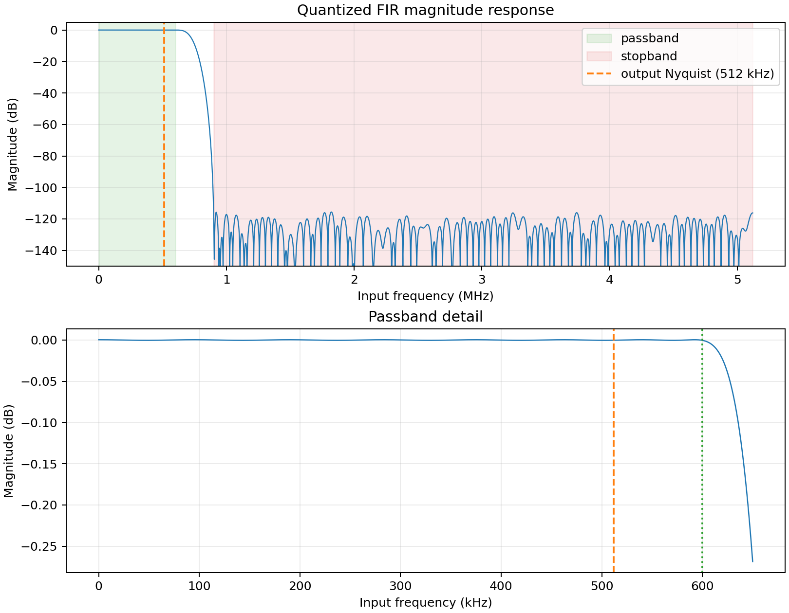

# 数字信号处理模块

## FFT

题目要求提取输入信号的各谐波分量，即将采样信号从时域转换到频域。对于连续时间信号，可以采用傅里叶变换提取频域信息：

$$ F(\omega) = \int_{-\infty}^{\infty} f(t) e^{-j\omega t} dt $$

而对于采样后得到的离散有限序列，无法直接使用傅里叶变换，需要使用离散傅里叶变换（DFT）来提取频域信息：

$$ X[k] = \sum_{n=0}^{N-1} x[n] e^{-j\frac{2\pi}{N}kn}, \quad k = 0, 1, 2, \ldots, N-1 $$

计算得到的序列 $X[k]$ 的长度为 $N$，其对应的频率为：

$$ f[k] = \frac{k}{N}f_s, \quad k = 0, 1, 2, \ldots, N-1 $$

其值经过归一化后可得到各频率分量的幅值信息：

$$ A[0] = \frac{|X[0]|}{N} $$
$$ A[k] = \frac{2|X[k]|}{N}, \quad k = 1, 2, \ldots, \frac{N}{2}-1 $$

DFT 的计算涉及到序列循环遍历求和，复杂度为 $O(N^2)$，当序列长度较大时计算量较大。快速傅里叶变换（FFT）是一种基于分治思想的、能够高效计算 DFT 的算法，其复杂度为 $O(N\log_2N)$，因此在实际工程中通常使用 FFT 来计算 DFT。

在本设计中，题目要求频率分辨率不大于 500Hz，此时有不等式：

$$ \Delta f = \frac{f_s}{N} \leq 500\text{Hz} $$

该不等式作为后续选择采样频率的约束条件。

然而在实际工程中，信号长度通常不恰好为周期的整数倍，直接使用 DFT 会引入频谱泄漏现象。为了解决这一问题，可以在采样信号上加窗，常用的窗函数有矩形窗、汉宁窗、汉明窗等。在本设计中，采用汉宁窗对采样信号进行加窗处理，汉宁窗的定义如下：

$$ w[n] = 0.5 - 0.5\cos\left(\frac{2\pi n}{N-1}\right), \quad n = 0, 1, 2, \ldots, N-1 $$

加窗得

$$ x_w[n] = x[n] \cdot w[n], \quad n = 0, 1, 2, \ldots, N-1 $$

此时序列 $x_w[n]$ 的长度仍为 $N$，但左右两端都接近 0，周期延拓后不会出现不连续点，从而避免了频谱泄漏现象。使用窗函数可能会带来增益衰减。对于汉宁窗，其增益衰减为 0.5，因此在计算幅值时需要进行补偿：

$$ A[k] = \frac{2|X[k]|}{0.5N}, \quad k = 1, 2, \ldots, \frac{N}{2}-1 $$

## 采样

本设计的采样分为两次。第一次采样对模拟信号采样，主要目的是保留模拟滤波器未完全滤去的高频噪声防止混叠，进而用数字滤波彻底滤去高频噪声；第二次采样对数字信号采样，主要目的是调整数据量，在保证频率分辨率要求、奈奎斯特采样定理的前提下，尽量减少数据量，提升单片机处理速度。

对于第一次采样，经过模拟滤波后的噪声频率范围约为 1MHz-1.5MHz。为了防止混叠，采样频率 $f_{s1}$ 应至少大于 3MHz。

对于第二次采样，在保证频率分辨率不大于 500Hz 的前提下，采样频率 $f_{s2}$ 应满足：

$$ f_{s2} \geq 500N\text{Hz} $$

又依据奈奎斯特采样定理，信号源有效信号频率范围为 10kHz-500kHz，因此采样频率应满足：

$$ f_{s2} \geq 1\text{MHz} $$

另外，第二次采样因为是对数字信号采样，而数字信号本身是阶梯式的失真信号，如果直接进行采样会采样到混叠的高频失真分量。因此，第二次采样应当与第一次采样时钟同步，即第一次采样频率应为第二次采样频率的整数倍，且二者采样时钟同步。综合以上条件，第二次采样频率应满足：

$$ f_{s1} = kf_{s2}, \quad k \in \mathbb{Z}^+ $$

综合考虑单片机处理速度与单片机 FFT 序列处理容量，本设计选择

$$ f_{s1} = 10.24\text{MHz}, \quad f_{s2} = 1.024\text{MHz}, \quad N = 2048 $$

此时频率分辨率

$$ \Delta f = \frac{f_{s2}}{N} = 500\text{Hz} $$

满足要求，且采样过程中不会发生混叠。

## 数字滤波

根据分析，FPGA 采集到的信号中包含10kHz-500kHz的有效信号、1MHz-1.5MHz 的高频噪声，为了防止混叠，必须在第二次采样前将高频噪声滤除。保险起见，本设计选择通频带终点为 600kHz 、阻带起点为 900kHz 的低通数字滤波器。

该设计使用的FPGA型号是Cyclone IV E，其自带 FIR 数字滤波器 IP 核。FIR 数字滤波器的原理是将输入信号与有限冲激响应进行卷积运算。对于有限长的离散时间信号 \(x[n]\) 和有限长的离散时间系统冲激响应 \(h[n]\)，其卷积运算定义为：

$$ y[n] = \sum_{k=0}^{M-1} h[k] x[n-k] $$

由此得数字滤波器的频率响应

$$ H(e^{j\omega}) = \sum_{k=0}^{M-1} h[k] e^{-j\omega k} $$

其中，$M-1$ 为滤波器的阶数，$h[k]$ 为滤波器的系数。考虑到 FPGA 的资源限制与通阻带要求，本设计选择阶数为 222 的 FIR 数字滤波器。使用Python的scipy.signal.remez函数设计出满足通阻带要求的滤波器系数，得到 223 个对称系数。最后得到的频响特性如下：

通带最大增益与最小增益分别是+0.000375/−0.000376 dB，总纹波 0.000751 dB；阻带最大幅值为 −115.6125 dB，对应幅度比约 $1.66\times10^{-6}$。总体满足设计要求。

ADC 推送采样点的速率为 10.24 MS/s，而二级采样的速率为 1.024 MS/s，因此数字滤波器每卷积 10 次推送一次采样点，单片机以 25MHz 的SPI时钟接收数据，远大于 1.024 MS/s 的采样速率，保证了数据不会丢失。
