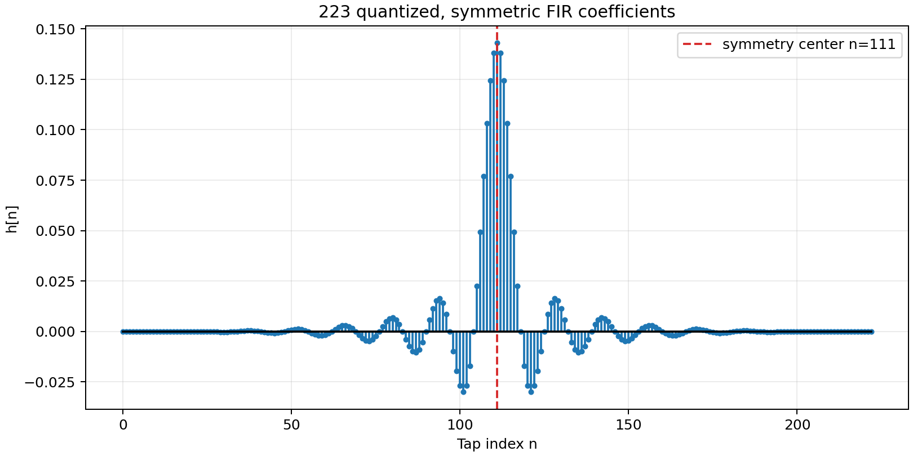
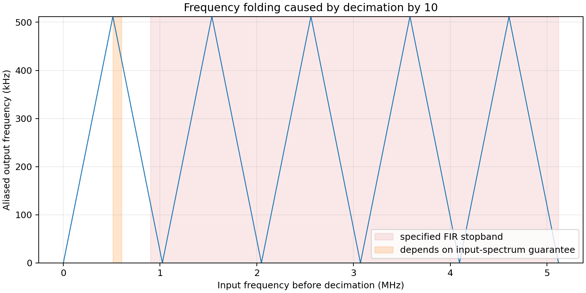

# FPGA 数字滤波与 10 倍抽取模块分析报告

## 1. 结论摘要

当前 FPGA 主工程实际使用 `fir_decim10`，它是 Intel/Altera FIR II 生成的**单级、线性相位、低通 FIR 抽取器**。模块接收 10.24 MS/s、12 bit 二进制补码 ADC 样本，在滤波后每 10 个输入样本给出一个输出样本，输出速率为 1.024 MS/s、宽度仍为 12 bit。

| 项目 | 实际值 |
|---|---:|
| FPGA 器件系列 | Cyclone IV E |
| FIR 运算时钟 | 100 MHz |
| 输入采样率 | 10.24 MS/s |
| 抽取倍数 $M$ | 10 |
| 输出采样率 | 1.024 MS/s |
| 输入/输出格式 | 12 bit 有符号整数 |
| 通带边缘 | 600 kHz |
| 阻带边缘 | 900 kHz |
| 过渡带宽 | 300 kHz |
| 抽头数/滤波器阶数 | 223 / 222 |
| 系数格式 | 24 bit 有符号 Q1.23 |
| 系数结构 | 实数、对称、1 组、不可动态重载 |
| 内部全精度累加宽度 | 44 bit |
| 输出量化 | 去除 23 个 LSB 时舍入；MSB 溢出时饱和 |
| 量化后通带纹波 | 0.000751 dB |
| 量化后阻带最大值 | −115.6125 dB |
| 线性相位群延迟 | 111 个输入样本，即约 10.84 μs（算法延迟） |

上述频响指标由 `python/fir.py` 对**量化后的实际系数**测得，而非仅对浮点设计原型测得。IP 配置中的 223 个固定整数与 `fir_coef.txt` 逐项一致。

## 2. 阅读范围与版本辨析

主要依据如下：

- `fpga/src/main.v`：当前顶层连接、时钟、数据格式转换和输出握手；
- `fpga/main.qsf`：工程实际加入的是 `fir_decim10/fir_decim10.qip`；
- `fpga/fir_decim10/fir_decim10.sopcinfo`：FIR II 的参数快照；
- `fpga/fir_decim10/fir_decim10_rtl_core.vhd`：生成后的定点数据通路；
- `python/fir.py` 与根目录 `fir_coef.txt`：当前单级抽取滤波器的设计和系数；
- `python/fir_multistage.py`、`fir_stage1_coef.txt`、`fir_stage2_coef.txt`：另一套 20→5→2.5 MS/s 的两级候选设计，**没有接入当前顶层**；
- `fpga/fir.*`：旧的普通 FIR IP，当前 QSF 未引用，不能代表现行实现。

因此，本报告的定量结论以 `fir_decim10` 和 `python/fir.py` 为准。

## 3. 从 ADC 到 MCU 的数据通路

```text
12-bit offset-binary ADC
        │ 10.24 MS/s, clk_adc
        ▼
ADC 模块：下降沿锁存 + toggle 跨时钟域
        │ 12-bit two's complement + adc_valid
        ▼
fir_decim10：223-tap FIR + ↓10
        │ 12-bit two's complement + filtered_valid, 1.024 MS/s
        ▼
符号位翻转：恢复 offset binary
        ▼
1-sample pending buffer → 25 MHz SPI mode 0 → MCU
```

50 MHz 输入经 `pll` 的 $2/1$ 配置产生 100 MHz `clk_proc`；独立 `pll_adc` 按 $128/625$ 产生 10.24 MHz ADC 时钟。ADC 数据在 `clk_adc` 下降沿锁存，通过翻转位和两级同步器跨到 100 MHz 域，每发现一次翻转就产生单周期 `adc_valid`。这使 FIR 的时钟是 100 MHz，但“有效输入样本率”是 10.24 MS/s；二者不应混淆。

ADC 原始码采用偏移二进制。`ADC` 模块只翻转最高位：

$$
\text{two's-complement code}=\{\neg b_{11},b_{10:0}\},
$$

这将 `0x000, 0x800, 0xFFF` 分别映射为 `−2048, 0, +2047`。FIR 输出后再翻转符号位，恢复给 MCU 使用的偏移二进制。

FIR 的 Avalon-ST 包装没有 `ready` 回压输入；顶层必须按 IP 配置的吞吐能力提供 `valid`。输出由 `filtered_valid` 标记，不能假定每个 100 MHz 时钟都有新数据。一级 pending 寄存器将 FIR 与 SPI 解耦；若新输出到达时旧样本尚未发走，粘滞位 `spi_overflow` 会置 1。25 MHz SPI 发送 12 bit 理论需约 0.48 μs（另有少量控制边界），短于 0.9765625 μs 的输出周期，因此正常配置有余量。

## 4. FIR 的数学原理

### 4.1 有限长卷积

223 抽头 FIR 的基本关系为

$$
v[n]=\sum_{k=0}^{222}h[k]x[n-k].
$$

它保存最近 223 个输入样本，分别乘以 223 个固定系数后相加。因为冲激响应 $h[k]$ 长度有限，系统没有由输出反馈到输入的递归环路，故称有限冲激响应（FIR）滤波器。只要系数有限，它就是 BIBO 稳定的。

### 4.2 低通频率选择

复指数 $x[n]=e^{j\omega n}$ 输入后仍保持同频率，仅被

$$
H(e^{j\omega})=\sum_{k=0}^{222}h[k]e^{-j\omega k}
$$

缩放和移相。因此 $|H|$ 描述不同频率被保留或抑制的程度。这里 0–600 kHz 为设计通带，900 kHz–5.12 MHz 为设计阻带，600–900 kHz 为允许响应从 1 下降到接近 0 的过渡带。


量化后结果：

- 通带最大/最小值近似为 $+0.000375/-0.000376$ dB，总纹波 0.000751 dB；
- 通带最坏幅值相对误差约 $10^{0.000375/20}-1=4.32\times10^{-5}$，即 0.00432%；
- 阻带最大幅值为 −115.6125 dB，对应幅度比约 $1.66\times10^{-6}$；
- 这里的 dB 是**幅度**定义 $20\log_{10}|H|$，不是功率的 $10\log_{10}$。

图中的深窄陷波可低于 −115.6 dB，但指标看的是整个阻带中“最高的泄漏峰”，不能拿最深陷波代替阻带最坏值。

### 4.3 对称系数、线性相位与延迟

系数满足

$$
h[k]=h[222-k].
$$

223 为奇数，因此这是 Type-I 线性相位 FIR。其频率响应可写成一个实偶幅度项与纯延时项的乘积，相位在通带内近似

$$
\angle H(e^{j\omega})=-111\omega,
$$

群延迟为恒定的 111 个输入样本：

$$
\tau_g=\frac{111}{10.24\times10^6}\approx10.84\ \mu s.
$$

这表示不同通带频率成分经历相同延迟，波形形状不会因非线性相位而失真。它是滤波器的算法延迟；FIR II 的流水线和跨时钟域还会增加若干 100 MHz 时钟周期的实现延迟，不能在没有时序仿真时把二者等同。



对称性也允许先计算 $x[n-k]+x[n-(222-k)]$，再乘一次 $h[k]$，理论上将独立乘法数由 223 降到 112。生成 RTL 中可见 13 bit 对称预加器以及时分复用的乘加结构；IP 参数给出 `incycles=9`，利用 100 MHz 运算时钟相对 10.24 MS/s 样本流的约 9.77 倍时钟余量复用 DSP 资源。

## 5. 为什么滤波后才能抽取

10 倍抽取只保留

$$
y[m]=v[10m].
$$

于是

$$
f_{s,out}=\frac{10.24\ \text{MHz}}{10}=1.024\ \text{MHz},\qquad
f_{N,out}=512\ \text{kHz}.
$$

抽取会把相隔 1.024 MHz 整数倍的输入频率折叠到相同输出频率。用归一化角频率表示，

$$
Y(e^{j\omega})=\frac{1}{10}\sum_{r=0}^{9}
V\!\left(e^{j(\omega+2\pi r)/10}\right).
$$

这说明输出并非仅含原来的低频谱，而是十份移位频谱之和。若不先低通，高频干扰会伪装成低频，抽取以后无法区分和恢复。



### 5.1 本设计必须强调的频谱前提

项目注释声明：有效被测信号在 0–500 kHz；500 kHz–1 MHz 不会有输入；已知带外干扰从 1 MHz 以上开始。600 kHz 通带边缘给 500 kHz 有效上限留了 100 kHz 裕量，900 kHz 阻带边缘又在 1 MHz 干扰起点前留了 100 kHz 裕量。

但输出奈奎斯特频率只有 512 kHz，所以 **512–600 kHz 虽属于 FIR 通带，却已经不能在输出中唯一表示**。例如 550 kHz 抽取后会折叠为 $1.024-0.550=0.474$ MHz。当前方案之所以可用，依赖“500 kHz–1 MHz 无输入”的系统保证。

由此得到两条边界：

1. 若外部信号可能出现在 512–900 kHz，该滤波器不能单独保证无混叠；
2. “115 dB 阻带”从 900 kHz 才开始成立，不能把它误认为所有 512 kHz 以上均有 115 dB 抑制。

## 6. Python 系数设计过程

`python/fir.py` 的工作流程如下。

### 6.1 将 dB 规格变成 Remez 权重

通带纹波规格 $R_p=0.002$ dB 被换算成线性等波纹偏差

$$
\delta_p=\frac{10^{R_p/20}-1}{10^{R_p/20}+1},
$$

阻带衰减 $A_s=115$ dB 被换算为

$$
\delta_s=10^{-A_s/20}.
$$

`remez` 使用权重 $[1/\delta_p,1/\delta_s]$，在通、阻带上求加权最大误差尽可能小的 Parks–McClellan 等波纹解。与最小均方误差不同，它控制的是各频带内最坏点。

### 6.2 搜索最短奇数长度

程序从 31 到 255 逐个测试奇数抽头数。选择奇数长度可得到 Type-I 对称 FIR 和整数样本群延迟。每次浮点设计后都先量化，再用 262144 点 `freqz` 检查：

$$
R_{p,meas}\le0.002\ \text{dB},\qquad
\max_{f\ge900\text{kHz}}20\log_{10}|H(f)|\le-115\ \text{dB}.
$$

第一个通过者为 223 抽头。这里的“最短”只表示在该搜索范围、奇数长度、SciPy Remez 参数和离散频率网格下第一个通过的候选，不是形式化的全局最优证明。

### 6.3 Q1.23 量化

浮点系数按

$$
q_k=\operatorname{round}(h_k2^{23}),\qquad
\hat h_k=q_k/2^{23}
$$

量化。24 bit 二进制补码整数范围是 $[-2^{23},2^{23}-1]$，量化步长为 $2^{-23}\approx1.1921\times10^{-7}$。最大系数约 0.14297545，对应整数 1199365，不会溢出。输出文件保留 17 位有效数字，使每一个二进制浮点 Q23 值传入 FIR II 时仍落在预期整数格点。

一个易混点是 Q1.23 的“1”：本文按**共 24 bit、含一个符号/整数位和 23 个小数位**解释，其可表示范围约为 $[-1,1)$，并不表示“符号位之外还有一个完整整数位”。

### 6.4 与 FPGA 定点实现的对应

12 bit 输入乘 24 bit 系数后需要约 36 bit；多个乘积求和需要额外保护位。生成核心暴露 44 bit 有符号累加结果。FIR II 最终：

- 删除 23 个小数 LSB，并采用 round 而非简单截断；
- 保留 12 bit 输出，超出可表示范围时 saturation 到 −2048 或 +2047，而不是回绕；
- 直流增益 $\sum h[k]$ 约为 1，因此满量程附近仍可能因通带微小峰值、舍入或瞬态产生饱和。

## 7. 实现特性、风险与验证建议

### 7.1 已由静态代码和 Python 验证的内容

- 顶层确实实例化并编译 `fir_decim10`；
- 时钟率、采样率、抽取倍数、数据位宽、223 个系数和量化格式相互一致；
- 系数严格对称，量化后频响满足脚本内规格；
- `filtered_valid` 的目标平均速率是 1.024 MS/s；
- 输出舍入、饱和配置和 44 bit 内部累加宽度已写入生成 IP 元数据/RTL。

### 7.2 尚不能仅由这些文件证明的内容

- 实际模拟前端是否真的保证 500 kHz–1 MHz 无能量；
- 板上 ADC 时钟抖动、模拟抗混叠滤波器和噪声对最终动态范围的影响；
- Quartus 完整编译后的资源、最高时钟频率及所有时序约束是否收敛；
- FIR IP 从输入 `valid` 到输出 `valid` 的精确流水线周期数；
- SPI 在硬件上是否从不触发 `spi_overflow`。

115 dB 是数学滤波器的阻带幅度指标，不等于整机一定具备 115 dB 动态范围。12 bit 理想量化信噪比常用估计只有约 $6.02N+1.76=74$ dB，实际 ADC、时钟和模拟链路还会进一步限制系统指标；较深的 FIR 阻带仍有价值，因为它可让混叠泄漏低于其他主要误差源。

### 7.3 建议的后续验证

1. 用软件模型逐样本模拟“Q1.23 乘法—44 bit 累加—舍入—12 bit 饱和—抽取”，与 HDL 仿真逐码比对；
2. 对 0、500、512、550、600、900 kHz 及 1 MHz 以上扫频，特别观察折叠频点；
3. 以满量程直流、通带正弦和阶跃检查饱和及启动瞬态；
4. 在 SignalTap 中同时捕获 `adc_valid`、`filtered_valid`、`spi_launch`、`spi_overflow`；
5. 若输入频谱保证不能成立，将通带改到不高于 500 kHz，并令阻带在 524 kHz 左右开始，或调整输出采样率/抽取倍数；这会显著增加所需抽头数，应重新做资源评估。

## 8. 图表复现

在仓库根目录执行：

```powershell
python report/generate_fir_figures.py
python python/fir.py
```

第一条命令由现有 `fir_coef.txt` 重绘本文三幅图；第二条会重新搜索并覆盖 `fir_coef.txt`，同时打印测量指标。依赖为 NumPy、SciPy 和 Matplotlib。
